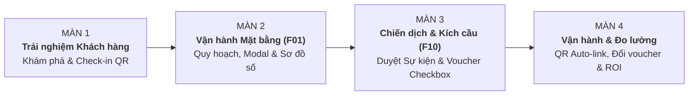

# KỊCH BẢN VÀ LUỒNG DEMO HỆ THỐNG TRUNG TÂM THƯƠNG MẠI ANEON
> **Tài liệu hướng dẫn trình diễn sản phẩm (Product Live Demo Script) — Phiên bản cập nhật mới nhất**  
> **Thời lượng đề xuất**: 15 – 20 phút | **Hệ thống**: Trung tâm Thương mại Thông minh ANEON (Phân hệ F01 & F10)

---

## 1. THÔNG TIN CHUNG VỀ BUỔI DEMO

### 1.1. Mục tiêu buổi trình diễn
- Trình diễn toàn diện năng lực số hóa của **Hệ thống Quản lý TTTM ANEON** theo hành trình thực tế của các bên liên quan.
- Chứng minh tính khép kín của quy trình nghiệp vụ: từ **Quy hoạch mặt bằng (F01)** đến **Tổ chức sự kiện, Kích cầu khuyến mãi & Trải nghiệm khách hàng (F10)**.
- Làm nổi bật các **cải tiến công nghệ & trải nghiệm người dùng (UX) mới nhất**:
  1. **Giao diện Popup Modal tập trung**: Toàn bộ thao tác Thêm mới / Chỉnh sửa / Xem chi tiết đều mở trong cửa sổ Modal nổi, không làm nhảy cuộn trang.
  2. **Bộ chọn nhiều gian hàng bằng Checkbox (MultiSelectCheckboxField)**: Bỏ hoàn toàn thao tác giữ phím `Ctrl/Cmd` rườm rà; hỗ trợ tìm kiếm nhanh, nút "Chọn tất cả" và đếm số lượng trực quan.
  3. **Ràng buộc liên kết động Khu vực ➔ Vị trí (Cascading Select)**: Ngăn chặn 100% lỗi chọn nhầm vị trí của khu vực/tầng khác.
  4. **Kiểm soát chặt chẽ giá trị Voucher**: Tự động giới hạn trần 100% đối với loại giảm giá %, placeholder chuẩn hóa định dạng.
  5. **Hỗ trợ Check-in tự động liên kết mã QR**: Nhân viên chỉ cần chọn tên Sự kiện, hệ thống tự động nhận diện và gán mã Token ngầm mà không cần nhớ hay copy-paste chuỗi ký tự phức tạp.
  6. **Trải nghiệm quét mã QR Check-in thân thiện**: Tự động bảo toàn thông tin sự kiện khi khách chưa đăng nhập; hiển thị giao diện 1 chạm ngay sau khi kết nối tài khoản.

### 1.2. Môi trường và điều kiện chuẩn bị trước demo
Trước khi bắt đầu buổi demo, người thuyết trình cần chuẩn bị:
1. **Dịch vụ đang chạy**:
   - Backend Spring Boot: `http://localhost:8080` (Môi trường local database MySQL)
   - Frontend Next.js: `http://localhost:3000`
2. **Mở sẵn 3 tab trình duyệt**:
   - **Tab 1 (Cổng Khách hàng)**: `http://localhost:3000/` (Trang chủ) & `http://localhost:3000/kham-pha`
   - **Tab 2 (Cổng Quản lý Nghiệp vụ)**: `http://localhost:3000/quan-ly`
   - **Tab 3 (Cổng Check-in di động của khách)**: `http://localhost:3000/check-in`

### 1.3. Bảng phân vai tài khoản sử dụng trong kịch bản
Hệ thống tích hợp sẵn danh sách tài khoản mẫu trong ô chọn danh tính (Local Presets), người demo chỉ cần chọn trực tiếp trong dropdown mà không cần gõ mật khẩu:

| Tên vai trò | Tài khoản mẫu trên giao diện | Trách nhiệm chính trong demo |
| :--- | :--- | :--- |
| **Khách mua sắm** | `Khách demo (aneon-demo-customer)` | Tra cứu gian hàng, xem ưu đãi, quét QR check-in sự kiện |
| **Ban Quản lý TTTM** | `Ban quản lý demo (aneon-demo-management)` | Quản lý mặt bằng, gian hàng, theo dõi tỷ lệ lấp đầy, tạo khuyến mãi |
| **Chuyên viên Marketing** | `Marketing demo (aneon-demo-marketing)` | Lập đề xuất sự kiện, tạo mã QR, ghi nhận chi phí tổ chức |
| **Ban Giám Đốc** | `Ban Giam Doc ANEON (giamdoc)` | Phê duyệt đề xuất sự kiện và cấp ngân sách chính thức |
| **Chuyên viên Vận hành** | `Chuyen Vien Van Hanh (vanhanh)` | Hỗ trợ check-in tại quầy, xác nhận đổi/áp dụng voucher |

---

## 2. TỔNG QUAN HÀNH TRÌNH TRÌNH DIỄN (STORYLINE)

Buổi demo được kể theo câu chuyện thực tế:  
**"Một ngày vận hành và kích cầu thương mại sôi động tại Trung tâm Thương mại Thông minh ANEON"** gồm 4 màn:

---

## 3. CHI TIẾT TỪNG BƯỚC THỰC HIỆN DEMO

---

### MÀN 1: TRẢI NGHIỆM KHÁCH HÀNG MUA SẮM (PUBLIC TOUCHPOINT)
> **Mục tiêu**: Cho khách hàng thấy TTTM ANEON không chỉ là điểm đến mua sắm truyền thống mà là không gian trải nghiệm số liền mạch và thân thiện.  
> **Thời lượng**: ~3 phút.

#### Bước 1.1: Trải nghiệm Trang chủ & Danh bạ gian hàng
- **Địa chỉ**: `http://localhost:3000/`
- **Lời dẫn (Speaker Script)**:  
  *"Kính thưa quý vị, điểm chạm đầu tiên của khách mua sắm khi đến với ANEON là Cổng thông tin số trực quan. Khách hàng có thể dễ dàng tra cứu vị trí các thương hiệu lớn như Uniqlo, Highlands Coffee theo từng tầng và ngành hàng."*
- **Thao tác**:
  1. Cuộn đến phần **"Danh mục ngành hàng"** và **"Danh sách gian hàng mẫu"**.
  2. Gõ từ khóa tìm kiếm: `Highlands` hoặc `Thần dược / Ẩm thực`.
  3. Bấm vào bộ lọc tầng: Chọn **"Tầng 1"** hoặc **"Tầng 2"** để thấy danh sách tự động cập nhật tức thì.

#### Bước 1.2: Khám phá Sự kiện & Ưu đãi hấp dẫn
- **Địa chỉ**: `http://localhost:3000/kham-pha`
- **Lời dẫn**:  
  *"Trước hoặc trong khi mua sắm, khách hàng mở tab 'Sự kiện & ưu đãi' để săn khuyến mãi giảm giá, voucher quà tặng và các lễ hội văn hóa đang diễn ra tại ANEON."*
- **Thao tác**:
  1. Tại thanh lọc, chọn Danh mục: **"Sự kiện"** hoặc **"Ưu đãi"**.
  2. Bấm vào một sự kiện nổi bật (Ví dụ: *Lễ hội Văn hóa Nhật Bản Sakura 2026* hoặc *Ngày hội trải nghiệm ANEON*).
  3. Nhấn vào nút **"Điều kiện áp dụng"** để đọc thể lệ chi tiết mà không bị chuyển trang.

---

### MÀN 2: QUẢN LÝ MẶT BẰNG & KHAI THÁC THƯƠNG MẠI (PHÂN HỆ F01)
> **Mục tiêu**: Chứng minh khả năng quản lý tài sản mặt bằng chặt chẽ, chống sai sót dữ liệu và cung cấp bức tranh vận hành tổng quan cho Ban Quản trị.  
> **Thời lượng**: ~5 phút.

#### Bước 2.1: Đăng nhập Cổng Quản lý với vai trò Ban Quản lý
- **Địa chỉ**: `http://localhost:3000/quan-ly`
- **Thao tác**:
  1. Tại ô **"Chọn tài khoản có sẵn"**, chọn `Ban quản lý demo (aneon-demo-management)`.
  2. Vai trò tự động hiển thị: `Ban quản lý`. Bấm **"Tiếp tục"**.
  3. Giao diện bảng điều khiển mở ra với thanh điều hướng nghiệp vụ bên trái.

#### Bước 2.2: Tạo mới mặt bằng với Cơ chế Liên kết động thông minh
- **Thao tác**:
  1. Bấm menu **"Mặt bằng"** (nhóm F01).
  2. Bấm nút **"Thêm mặt bằng mới"** ➔ **Popup Modal** mở ra nổi bật giữa màn hình.
  3. Nhập các trường thông tin mẫu:
     - **Mã mặt bằng**: `MB-DEMO-01`
     - **Tên**: `Gian hàng Trải nghiệm Mùa hè`
     - **Khu vực**: Chọn `Khu B1 - Hang Hieu Quoc Te (KV-B1) - Tang 1 - Thoi Trang & My Pham`.
     - **Tổng diện tích**: `75.5`
     - **Loại mặt bằng**: `Cửa hàng tiêu chuẩn (STORE)`
     - **Vị trí**:
       > **Điểm nhấn Công nghệ (Cascading Select)**: Ngay khi người dùng chọn *Khu B1*, trường *Vị trí* ngay lập tức tự động lọc và chỉ hiển thị các vị trí thuộc Khu B1 (`Hành lang quốc tế B1...`), đồng thời tự động điền vị trí hợp lệ đầu tiên kèm chú thích xanh:  
       > `Đã tự động lọc vị trí theo khu vực và chọn vị trí tương ứng.`  
       > Hệ thống ngăn chặn 100% lỗi chọn nhầm vị trí của khu vực khác.
     - **Trạng thái**: `Còn trống (VACANT)`
  4. Bấm **"Tạo mặt bằng"** ➔ Thông báo thành công hiển thị, modal tự đóng và danh sách tự làm mới.

#### Bước 2.3: Xem Sơ đồ số và Gắn vị trí mặt bằng
- **Thao tác**:
  1. Tại bảng danh sách, tìm mặt bằng vừa tạo hoặc mặt bằng mẫu `MB-A01`, bấm nút **"Chi tiết"**.
  2. Modal chi tiết hiện lên đầy đủ thông số kỹ thuật.
  3. Mở phần **"Gắn vị trí mặt bằng"**:
     - Sơ đồ mặt bằng số hiển thị tọa độ các vị trí trực quan. Bấm chọn vị trí trên bản đồ để cập nhật tọa độ chỉ bằng 1 cú nhấp chuột.
     - *(Nếu khu vực chưa phát hành sơ đồ số, hệ thống hiển thị thông báo nhẹ nhàng "Chưa phát hành sơ đồ" thay vì báo lỗi hệ thống).*

#### Bước 2.4: Báo cáo Tỷ lệ Khai thác (Occupancy Rate) & Nhật ký kiểm toán
- **Thao tác**:
  1. Bấm menu **"Tình hình khai thác"**.
  2. **Lời dẫn**:  
     *"Toàn bộ số liệu tỷ lệ lấp đầy, tổng diện tích cho thuê, số gian hàng còn trống và đang bảo trì được tính toán tự động theo thời gian thực, giúp Ban Quản lý ra quyết định kinh doanh chuẩn xác."*
  3. Bấm menu **"Lịch sử thay đổi"** để chứng minh tính năng kiểm toán (Audit Trail) ghi vết mọi thay đổi trạng thái, thời điểm và tài khoản thực hiện.

---

### MÀN 3: CHIẾN DỊCH SỰ KIỆN, KHUYẾN MÃI & PHÁT HÀNH VOUCHER (PHÂN HỆ F10)
> **Mục tiêu**: Trình diễn luồng phê duyệt đa cấp mượt mà giữa Marketing và Giám Đốc, cùng công cụ kích cầu tiện lợi cho khách hàng.  
> **Thời lượng**: ~7 phút.

#### Bước 3.1: Marketing lập Đề xuất Sự kiện Mùa hè
- **Thao tác chuyển tài khoản**:
  1. Bấm **"Kết thúc phiên"** góc trên bên trái.
  2. Chọn tài khoản: `Marketing demo (aneon-demo-marketing)`. Bấm **"Tiếp tục"**.
- **Tạo bản nháp sự kiện**:
  1. Bấm menu **"Sự kiện"** (nhóm F10).
  2. Bấm nút **"Đề xuất sự kiện mới"** (Popup Modal xuất hiện).
  3. Nhập thông tin:
     - **Mã sự kiện**: Để trống (Hệ thống tự sinh mã chuẩn `SK-xxxxxx`) hoặc nhập `SK-HE-2026`.
     - **Tên sự kiện**: `Đại Hội Ẩm Thực Mùa Hè ANEON 2026`
     - **Dự toán ngân sách (₫)**: `35000000` (35 triệu VNĐ)
     - **Khách mục tiêu**: `500`
     - **Thời gian**: Bắt đầu từ ngày mai, kết thúc sau 3 ngày.
     - **Khu vực tổ chức**: Chọn `Sảnh chính` hoặc `Khu triển lãm`.
  4. Bấm **"Lưu bản nháp"**.
  5. Bấm vào sự kiện vừa tạo trong bảng (mở Modal chi tiết), chọn **"Gửi bản nháp để duyệt"**. Trạng thái sự kiện chuyển sang `PENDING_APPROVAL`.

#### Bước 3.2: Ban Giám Đốc xem xét và Phê duyệt Ngân sách
- **Thao tác chuyển tài khoản**:
  1. Bấm **"Kết thúc phiên"** ➔ Chọn `Ban Giam Doc ANEON (giamdoc)`. Bấm **"Tiếp tục"**.
- **Duyệt sự kiện**:
  1. Bấm menu **"Sự kiện"**, tìm sự kiện `Đại Hội Ẩm Thực Mùa Hè ANEON 2026` đang ở trạng thái `PENDING_APPROVAL`.
  2. Bấm **"Chi tiết"** (Mở Modal).
  3. Bấm **"Duyệt đề xuất"**:
     - **Ngân sách duyệt (₫)**: `30000000` (Phê duyệt 30 triệu VNĐ)
     - **Ghi chú**: `Đồng ý chủ trương, yêu cầu đảm bảo an toàn vệ sinh thực phẩm.`
  4. Bấm **"Duyệt sự kiện"** ➔ Trạng thái chuyển ngay sang `APPROVED`.

#### Bước 3.3: Lập Lịch hoạt động & Tạo Mã QR Check-in công nghệ
- **Thao tác**: (Vẫn ở Modal chi tiết sự kiện đã duyệt)
  1. Mở phần **"Lịch hoạt động"** ➔ Bấm **"Thêm hoạt động"**:
     - Tên hoạt động: `Khai mạc & Trình diễn ẩm thực Nhật Bản`
     - Khung giờ: 09:00 – 11:30 (Hệ thống tự kiểm tra không trùng lịch sảnh với sự kiện khác).
  2. Mở phần **"Tạo mã QR check-in"** ➔ Bấm **"Tạo mã QR"**.
  3. Hệ thống tạo ra một liên kết Check-in độc quyền kèm mã Token bảo mật dạng:  
     `http://localhost:3000/check-in?token=...&event=...`
  4. Copy đường dẫn này để chuẩn bị cho Màn 4.

#### Bước 3.4: Tạo Voucher Ưu đãi với Bộ chọn Checkbox nhiều gian hàng
- **Thao tác chuyển tài khoản**: Kết nối lại với `Ban quản lý demo (aneon-demo-management)`.
- **Tạo mẫu Voucher**:
  1. Bấm menu **"Voucher"**.
  2. Bấm **"Tạo mẫu voucher mới"** (Mở Popup Modal).
  3. Điền thông số:
     - **Mã**: Bỏ trống (Hệ thống tự cấp mã chuẩn `VCxxxxxx`) hoặc nhập `VC-HE20`.
     - **Tên**: `Voucher Ẩm Thực Hè 20%`
     - **Loại giảm**: `Phần trăm`
     - **Giá trị giảm**: `20` (Hệ thống tự động khóa chặn không cho nhập vượt quá 100%).
     - **Mức giảm tối đa (₫)**: `100000`
     - **Giá trị hóa đơn tối thiểu (₫)**: `200000`
     - **Gian hàng áp dụng**:
       > **Điểm nhấn UI mới**: Giao diện hiển thị danh sách **Checkbox** chuyên nghiệp thay vì select multiple. Người dùng chỉ cần click chọn `CH-HIGHLANDS` và `CH-A01`, có thanh tìm kiếm nhanh, nút **"Chọn hết / Bỏ chọn"** và bộ đếm `Đã chọn: 2 / 12`.
  4. Bấm **"Tạo voucher"**.
- **Phát voucher cho khách hàng**:
  1. Tại mục **"Phát voucher cho khách"**:
     - Chọn mẫu voucher: `Voucher Ẩm Thực Hè 20%`.
     - Chọn khách hàng: `Khách demo` hoặc `Nguyen Van An`.
  2. Bấm **"Phát voucher"** ➔ Khách hàng ngay lập tức sở hữu phiếu ưu đãi trong ví cá nhân.

---

### MÀN 4: CHECK-IN SỰ KIỆN, ĐỔI VOUCHER & BÁO CÁO THỜI GIAN THỰC
> **Mục tiêu**: Hoàn tất chu trình tương tác thực tế giữa khách hàng và nhân viên vận hành tại quầy.  
> **Thời lượng**: ~4 phút.

#### Bước 4.1: Khách hàng tự quét mã QR Check-in (Self Check-in)
- **Địa chỉ**: Mở Tab 3 hoặc dán liên kết check-in đã copy ở Bước 3.3 vào trình duyệt (`/check-in?token=...&event=...`).
- **Kịch bản thực tế**:
  1. **Nếu chưa đăng nhập**: Màn hình hiển thị khung đăng nhập nhận diện khách hàng. Tham số sự kiện và mã Token trên đường link được **bảo toàn 100%**, khách không cần quét lại mã QR.
  2. **Sau khi kết nối tài khoản khách**: Màn hình tự động nhận diện và hiển thị hộp thông báo màu xanh lá:  
     `✅ Đã nhận diện mã QR sự kiện hợp lệ - Tài khoản khách: Khách demo`
  3. Khách chỉ cần bấm **"Xác nhận check-in"** (1 chạm).
  4. Thông báo thành công hiển thị rực rỡ kèm mốc thời gian chính xác.
  5. **Chống quét trùng lặp**: Bấm lại nút Check-in một lần nữa ➔ Hệ thống lập tức thông báo: *"Bạn đã check-in sự kiện này lúc..."*, chống gian lận lặp điểm thưởng.

#### Bước 4.1b: Nhân viên Hỗ trợ Check-in tự động (Không cần nhớ mã Token)
- **Địa chỉ**: Tab Quản lý `http://localhost:3000/quan-ly`
- **Tài khoản**: `Chuyen Vien Van Hanh (vanhanh)` hoặc `Marketing demo`.
- **Kịch bản**: Khách cao tuổi hoặc máy hết pin đến quầy nhờ check-in hộ.
- **Thao tác**:
  1. Bấm menu **"Hỗ trợ check-in"** (nhóm F10).
  2. Tại trường **"Sự kiện"**, chọn `Đại Hội Ẩm Thực Mùa Hè ANEON 2026`.
  3. > **Điểm nhấn Thông minh (Auto-Link)**: Ngay khi chọn Sự kiện, hệ thống tự động gọi API tìm mã QR đang kích hoạt và hiển thị:  
     > `✅ Đã tự động liên kết mã QR đang hoạt động của sự kiện (Token: ...)`  
     > Nhân viên **hoàn toàn không cần phải nhớ hay copy-paste chuỗi token 43 ký tự thủ công**.
  4. Tại trường **"Khách mua sắm"**, chọn khách hàng cần hỗ trợ (ví dụ `Tran Thi Binh`).
  5. Bấm **"Xác nhận check-in cho khách"** ➔ Xác nhận thành công ngay lập tức!

#### Bước 4.2: Nhân viên xác nhận sử dụng Voucher tại quầy thu ngân
- **Địa chỉ**: Tab Quản lý `http://localhost:3000/quan-ly`
- **Tài khoản**: `Chuyen Vien Van Hanh (vanhanh)`.
- **Thao tác**:
  1. Bấm menu **"Voucher"**, mở mục **"Đổi / Sử dụng voucher"**.
  2. Chọn mã voucher của khách hàng vừa nhận.
  3. Bấm **"Xác nhận sử dụng"** ➔ Trạng thái voucher chuyển sang `USED` tức thì, ngăn chặn việc tái sử dụng.

#### Bước 4.3: Báo cáo Tổng kết Sự kiện & Đo lường ROI
- **Tài khoản**: `Marketing demo` hoặc `Ban Giam Doc ANEON`.
- **Thao tác**:
  1. Vào menu **"Sự kiện"**, bấm chi tiết sự kiện `Đại Hội Ẩm Thực Mùa Hè ANEON 2026`.
  2. Mở mục **"Ghi nhận chi phí"**: Nhập chi phí âm thanh, ánh sáng `8500000` ₫.
  3. Cuộn đến phần **"Báo cáo tổng kết sự kiện"**:
     - Số lượng khách check-in thực tế: Đã tự động cộng dồn chính xác từ các lượt check-in ở Bước 4.1 và Bước 4.1b (+2 khách).
     - So sánh Tổng ngân sách duyệt vs Chi phí thực tế.
     - Đánh giá chỉ số ROI và hiệu quả tiếp cận khách hàng.
  4. Chuyển sang menu **"Khuyến mãi"** ➔ Mở **"Theo dõi số liệu khuyến mãi"**: Xem doanh thu kích cầu và tiền chiết khấu đã hỗ trợ các gian hàng.

---

## 4. BẢNG TỔNG HỢP DỮ LIỆU MẪU DÙNG CHO DEMO (CHEAT SHEET)

Người thuyết trình sử dụng các thông số chuẩn hóa dưới đây để thao tác mượt mà và chính xác 100%:

| Nghiệp vụ | Trường thông tin | Dữ liệu mẫu đề xuất |
| :--- | :--- | :--- |
| **Tạo mặt bằng (F01)** | Mã mặt bằng | `MB-DEMO-2026` |
| | Tên mặt bằng | `Gian hàng Trải nghiệm Mùa hè` |
| | Khu vực | `Khu B1 - Hang Hieu Quoc Te` |
| | Tổng diện tích | `75.5` |
| | Loại mặt bằng | `Cửa hàng tiêu chuẩn (STORE)` |
| | Vị trí | Hệ thống tự chọn vị trí trong Khu B1 |
| **Đề xuất sự kiện (F10)**| Mã sự kiện | Để trống (hệ thống tự sinh) hoặc `SK-HE-2026` |
| | Tên sự kiện | `Đại Hội Ẩm Thực Mùa Hè ANEON 2026` |
| | Ngân sách dự toán | `35000000` |
| | Khách mục tiêu | `500` |
| | Địa điểm | `Sảnh chính (Khu A)` |
| **Duyệt sự kiện (F10)** | Ngân sách duyệt | `30000000` |
| | Ghi chú | `Đồng ý kế hoạch tổ chức` |
| **Tạo Voucher (F10)** | Mã voucher | Để trống (tự sinh `VCxxxxxx`) hoặc `VC-HE20` |
| | Tên voucher | `Voucher Mùa Hè 20%` |
| | Loại giảm | `Phần trăm` |
| | Giá trị giảm | `20` (Tối đa 100%) |
| | Giảm tối đa | `100000` |
| | Hóa đơn tối thiểu | `200000` |
| | Gian hàng áp dụng | Tick chọn Checkbox: `CH-HIGHLANDS`, `CH-A01` |

---

## 5. HƯỚNG DẪN TRẢ LỜI CÁC CÂU HỎI THƯỜNG GẶP (Q&A PITCHING GUIDE)

### Câu 1: Làm thế nào để đảm bảo nhân viên không gán nhầm vị trí giữa các khu vực hoặc tầng khác nhau?
> **Trả lời**: Hệ thống ANEON áp dụng cơ chế **Validation 2 lớp**:  
> 1. *Tại giao diện (Frontend)*: Khi người dùng chọn một Khu vực, danh mục Vị trí ngay lập tức được lọc động chỉ chứa các vị trí thuộc khu vực đó.  
> 2. *Tại máy chủ (Backend)*: API kiểm tra toàn vẹn quan hệ giữa `zoneId` và `locationId`. Nếu không thuộc cùng phân vùng, hệ thống lập tức từ chối và phản hồi rõ ràng, loại bỏ 100% rủi ro dữ liệu sai lệch.

### Câu 2: Thao tác chọn nhiều gian hàng áp dụng voucher có thuận tiện trên máy tính bảng hoặc di động không?
> **Trả lời**: Rất thuận tiện. ANEON đã thay thế hoàn toàn thẻ chọn truyền thống (vốn bắt người dùng giữ phím Ctrl) bằng thành phần **MultiSelectCheckboxField**. Người dùng chạm hoặc click trực tiếp vào từng ô checkbox, có thanh tìm kiếm tên gian hàng tức thời và nút "Chọn tất cả" vô cùng linh hoạt.

### Câu 3: Khách hàng tham gia sự kiện có bắt buộc phải tải ứng dụng di động không?
> **Trả lời**: Hoàn toàn **không cần cài đặt ứng dụng**. Cổng trải nghiệm khách hàng của ANEON được xây dựng trên nền tảng Web di động (Mobile Web / PWA) tối ưu hóa cao. Khách hàng chỉ cần quét camera mã QR tại sự kiện là trang Check-in tự động mở ra, xác nhận trong chưa đầy 3 giây.

### Câu 4: Kiến trúc hệ thống có đáp ứng được khi có hàng ngàn khách cùng check-in hoặc đổi voucher không?
> **Trả lời**: Hệ thống xây dựng trên **Spring Boot 3** hiệu năng cao với cấu trúc phân tầng chuẩn mực, kết hợp cơ sở dữ liệu MySQL đã được đánh chỉ mục tối ưu trên các trường định danh và khóa ngoại. Các giao dịch đổi voucher và check-in đều áp dụng cơ chế khóa lạc quan (Optimistic Locking) và kiểm soát trùng lặp chặt chẽ, đảm bảo tính toàn vẹn dữ liệu ngay cả khi tải cao.

---

## 6. KẾT LUẬN & THÔNG ĐIỆP KẾT THÚC BUỔI DEMO

> *"Kính thưa quý khách hàng và hội đồng đánh giá,  
> Hệ thống Quản trị TTTM ANEON đã giải quyết trọn vẹn bài toán vận hành kép: vừa mang lại công cụ quản trị quy hoạch mặt bằng minh bạch, hiệu quả cho Ban Quản lý; vừa trao cho đội ngũ Marketing và Vận hành giải pháp kích cầu thương mại thông minh, tăng tính gắn kết của khách hàng.  
> Xin chân thành cảm ơn quý vị đã theo dõi buổi trình diễn. Rất mong nhận được những câu hỏi và ý kiến đóng góp quý báu!"*
